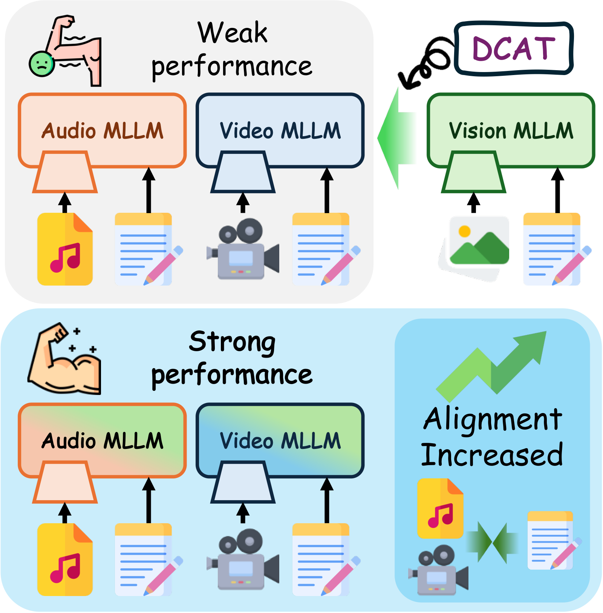
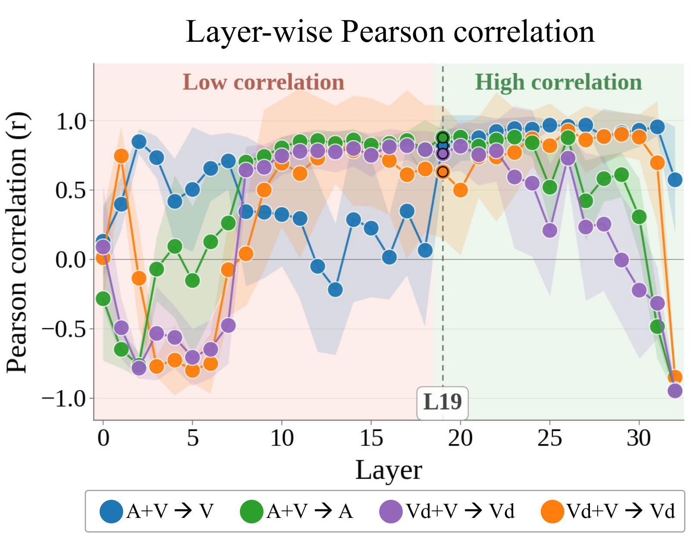

<div align="center">

# Strong Helps Weak: Directional Cross-Modal Alignment Transfer in Multi-modal LLMs<br>(NeurIPS 2026 Spotlight)

**Hoigi Seo**<sup>1\*</sup> &nbsp;&nbsp; **Byung Hyun Lee**<sup>1\*</sup> &nbsp;&nbsp; **Minjun Kim**<sup>1\*</sup><br>
**Dohyun Mah**<sup>1</sup> &nbsp;&nbsp; **Jongho Lee**<sup>1,2</sup> &nbsp;&nbsp; **Se Young Chun**<sup>1,2,3†</sup>

<sup>1</sup> Dept. of ECE &nbsp;&nbsp; <sup>2</sup> INMC &nbsp;&nbsp; <sup>3</sup> IPAI, Seoul National University, Republic of Korea

<sub>\* Equal contribution &nbsp;&nbsp; † Corresponding author</sub>

`{seohoiki3215, ldlqudgus756, minjoony, dohyun0505,`<br>`jonghoyi, sychun}@snu.ac.kr`

[](https://seohoiki3215.github.io/DCAT_project_page/)
[](https://arxiv.org/abs/2610.04580)
[](#citation)
[](https://www.python.org/)
[](https://pytorch.org/)

**[Project Page](https://seohoiki3215.github.io/DCAT_project_page/)** &nbsp;|&nbsp; **[Paper](https://arxiv.org/abs/2610.04580)** &nbsp;|&nbsp; **[Code](https://github.com/Hyun1A/DCAT)**

</div>

<p align="center">
  
</p>

**DCAT** transfers alignment from a strong, well-aligned **donor**-modality MLLM (vision) into a
weaker **recipient**-modality MLLM (audio / video), improving the recipient on its *own* benchmarks —
no fine-tuning, no gradients, only a few hundred unlabeled calibration samples and one closed-form
solve per projection.

---

## Released Checkpoints

| Setting | Recipient | Donor | Weights | Format |
|---|---|---|---|---|
| Vicuna · Vision → Audio | Vicuna-7B-v1.5 audio MLLM | Vicuna-7B-v1.5 vision MLLM | [🤗 Hyun1A/DCAT-Vicuna-Vision2Audio](https://huggingface.co/Hyun1A/DCAT-Vicuna-Vision2Audio) | adapter on top of `lmsys/vicuna-7b-v1.5` |
| Vicuna · Vision → Video | Vicuna-7B-v1.5 video MLLM | Vicuna-7B-v1.5 vision MLLM | [🤗 Hyun1A/DCAT-Vicuna-Vision2Video](https://huggingface.co/Hyun1A/DCAT-Vicuna-Vision2Video) | adapter on top of `lmsys/vicuna-7b-v1.5` |
| LLaMA 3.1 · Vision → Audio | Ultravox v0.4.1 (LLaMA-3.1-8B) | LLaVA LLaMA-3.1-8B | [🤗 Hyun1A/DCAT-LLaMA-Vision2Audio](https://huggingface.co/Hyun1A/DCAT-LLaMA-Vision2Audio) | full weights |
| LLaMA 3.1 · Vision → Video | LLaVA-Video LLaMA-3.1-8B | LLaVA LLaMA-3.1-8B | [🤗 Hyun1A/DCAT-LLaMA-Vision2Video](https://huggingface.co/Hyun1A/DCAT-LLaMA-Vision2Video) | full weights |

The Vicuna recipients and donor are the ModelCompose checkpoints released with
[OptMerge](https://github.com/EnnengYang/OptMerge) (`multimodal-vicuna-7b-v1.5-{audio,video,vision}-naivemc`).

---

## Quick Start

`quick_start/inference.py` downloads a released checkpoint and answers one question about an audio or
video file. It reuses the model-loading, prompt-formatting and decoding code of the evaluation, so with
`--choices` the prompt is exactly the one used for MMAU / Video-MME (greedy decoding).

**Vicuna settings**

```bash
git clone https://github.com/Hyun1A/DCAT.git && cd DCAT
conda create -n dcat_vicuna python=3.10 -y && conda activate dcat_vicuna
pip install torch==2.0.1 torchvision==0.15.2 torchaudio==2.0.2 --index-url https://download.pytorch.org/whl/cu117
pip install -r requirements_vicuna.txt

python quick_start/inference.py --setting vicuna-audio --model Hyun1A/DCAT-Vicuna-Vision2Audio \
    --media example.wav --question "Based on the given audio, identify the source of the speaking voice." \
    --choices Man Woman Child Robot

python quick_start/inference.py --setting vicuna-video --model Hyun1A/DCAT-Vicuna-Vision2Video \
    --media example.mp4 --question "What is the main content of this video?" \
    --choices "first option" "second option" "third option" "fourth option"
```

The Vicuna base LLM is taken from `lmsys/vicuna-7b-v1.5` (`--base` accepts a local path). The audio
encoder (BEATs) ships with the Vicuna audio checkpoint, and the video encoder
(`LanguageBind/LanguageBind_Video_merge`) is downloaded on first use; both are placed in
`~/.cache/dcat/encoders` unless `--encoder-dir` or `MODELCOMPOSE_ENCODER_DIR` points elsewhere.

**LLaMA 3.1 settings**

```bash
conda create -n dcat_llama python=3.10 -y && conda activate dcat_llama
pip install torch==2.7.0 torchvision==0.22.0 torchaudio==2.7.0 --index-url https://download.pytorch.org/whl/cu128
pip install -r requirements_llama.txt
git clone https://github.com/LLaVA-VL/LLaVA-NeXT.git third_party/LLaVA-NeXT
git -C third_party/LLaVA-NeXT checkout bce12e4
git -C third_party/LLaVA-NeXT apply ../llava_next_dcat.patch
pip install -e third_party/LLaVA-NeXT --no-deps
huggingface-cli login

python quick_start/inference.py --setting llama-audio --model Hyun1A/DCAT-LLaMA-Vision2Audio \
    --media example.wav --question "Based on the given audio, identify the source of the speaking voice." \
    --choices Man Woman Child Robot

python quick_start/inference.py --setting llama-video --model Hyun1A/DCAT-LLaMA-Vision2Video \
    --media example.mp4 --question "What is the main content of this video?" \
    --choices "first option" "second option" "third option" "fourth option"
```

Ultravox loads its language model from `meta-llama/Meta-Llama-3.1-8B-Instruct` before the merged
weights are copied in, so the audio setting needs a Hugging Face login with access to that model, or
`--text-model /path/to/Llama-3.1-8B-Instruct`. Without `--choices` the question is passed as is.
Checkpoints are cached in `~/.cache/dcat` (`DCAT_CACHE` overrides it), and `--model` also accepts a
local directory such as the output of `run_merge.sh`. One GPU with 24 GB is enough for the Vicuna
settings; the LLaMA 3.1 settings need about 40 GB.

---

## Method

Merging a vision MLLM into an audio MLLM makes the audio model better *at audio*. The reason is
**alignment**: how much modality-token energy sits inside the LLM's principal text subspace
(**SEO**), and how evenly it spreads across that subspace (**SD**). The paper proves a
mutual-information lower bound that is monotonic in their product — the **Alignment score** — and
shows it correlates strongly with downstream accuracy, most clearly from the middle layers onward.

<p align="center">
  
</p>

DCAT optimizes that quantity directly. Per linear projection it solves

$$\min_{\tau} \underbrace{\lVert X_{\text{mod}}(\theta_0+\tau)-T_\alpha\rVert_F^2}_{\text{self-alignment}} + \eta\cdot\underbrace{\Big(\beta\lVert X_{\text{text}}(\tau-\tau_r)\rVert_F^2+(1-\beta)\lVert X_{\text{text}}(\tau-\tau_d)\rVert_F^2\Big)}_{\text{cross-modal alignment}} + \eta_2\cdot\underbrace{\sum_{i\in\{r,d\}}\frac{\lVert(\tau-\tau_i)\,\tau_i^{\top}\rVert_F^2}{\lVert\tau_i\rVert_F^2}}_{\text{weight-space anchor (optional)}}$$

where $\tau_r,\tau_d$ are the recipient and donor task vectors and $T_\alpha$ is a norm-preserving
target built inside the text subspace with a rebalanced spectrum. The first term raises SEO and SD;
the second anchors the update between recipient and donor on text inputs, which is how the donor's
alignment actually gets transferred. The third term (`--eta2`, set per setting in each script) additionally keeps the
update inside the row spaces of the two task vectors; it is a small, closed-form-compatible addition
that helps on the video recipients and on Vicuna audio. All three terms are quadratic in $\tau$, so
each projection is still solved with one SPD linear solve. The target exponent $\alpha$ is scheduled
per projection from SEO/SD (`--alpha-sched ratio` or `balanced`, set per setting in each script).

**Calibration prompts.** $X_{\text{mod}}$ and $X_{\text{text}}$ are collected from 256 AVQA samples;
no evaluation data are used. With `--avqa-prompt evalfmt` (the default) each AVQA question and
its answer choices are written in the same prompt format the recipient sees at evaluation time — the
same instruction wording and, for the LLaMA models, the same chat template — so the text activations
that define the text subspace and the anchor term come from the input format the model is actually
used with. `--avqa-prompt native` keeps AVQA's original template.

---

## Installation

The two backbones need separate environments: the Vicuna settings run on **ModelCompose**, the
LLaMA 3.1 settings on **LLaVA-NeXT** and **Ultravox**. The commands are the ones in
[Quick Start](#quick-start); `requirements_vicuna.txt` and `requirements_llama.txt` pin the exact
versions used for the paper results (Python 3.10, CUDA 11.7 and 12.8).

- **ModelCompose** is included in `third_party/ModelCompose` (Apache-2.0). It is the copy the results
  were produced with, based on [MLLMerging](https://github.com/WalkerWorldPeace/MLLMerging) commit
  `8f205d4`, with encoder paths resolved from `MODELCOMPOSE_ENCODER_DIR` instead of fixed absolute
  paths. The scripts add it to `sys.path`; `pip install -e third_party/ModelCompose --no-deps` makes
  `import modelcompose` work elsewhere.
- **LLaVA-NeXT** is installed from commit `bce12e4` with `third_party/llava_next_dcat.patch`, which
  changes three files: it adds the `aapool_mlp` projector used by the LLaVA-Video LLaMA-3.1 checkpoint,
  keeps the last SigLIP layer that the LLaMA-3.1 checkpoints were trained with, and makes the Q-Former
  imports work with transformers 4.55.
- **Ultravox** needs no installation; its remote code ships with the checkpoint.

---

## Checkpoints and Data

Reproducing the merges needs the recipient and donor checkpoints, the encoders and the benchmark data
under one root directory:

```
$ROOT/
├── vicuna_models/
│   ├── checkpoints/
│   │   ├── vicuna-7b-v1.5/                              lmsys/vicuna-7b-v1.5
│   │   ├── multimodal-vicuna-7b-v1.5-audio-naivemc/      OptMerge release (recipient)
│   │   ├── multimodal-vicuna-7b-v1.5-video-naivemc/      OptMerge release (recipient)
│   │   └── multimodal-vicuna-7b-v1.5-vision-naivemc/     OptMerge release (donor)
│   └── multimodal_encoder/                              MODELCOMPOSE_ENCODER_DIR
│       ├── beats/BEATs_iter3_plus_AS2M.pt                BEATs iter3+ (AS2M)
│       └── LanguageBind_Video_merge/                     LanguageBind/LanguageBind_Video_merge
├── llama_models/checkpoints/
│   ├── llama3.1-8b-instruct/                            meta-llama/Llama-3.1-8B-Instruct
│   ├── ultravox_v0_4_1_llama_3_1_8b/                    fixie-ai/ultravox-v0_4_1-llama-3_1-8b (recipient)
│   ├── llava-video-llama-3.1-8b/                        LLaVA-Video LLaMA-3.1-8B (recipient)
│   └── llava-llama3.1-8b/                               LLaVA LLaMA-3.1-8B (donor)
└── data/
    ├── mmau/                                            test_mini.json + audio/
    ├── videomme/                                        videomme_test_flat.json + videos/data/<videoID>.mp4
    ├── AVQA_MUSIC-AVQA_supp/data/                       test/avqa-test_mm_*.json + evaluation_datasets/AVQA/audio/
    └── AVQA/constructed_avqa/videos/test/               AVQA video clips
```

The ModelCompose checkpoints keep the encoder paths of the original authors in `config.json`; the
vendored builder maps them to `beats/` and `LanguageBind_Video_merge/` inside
`MODELCOMPOSE_ENCODER_DIR` (a Hugging Face snapshot directory also works). The CLIP vision tower falls
back to `openai/clip-vit-large-patch14-336`.

Calibration uses 256 AVQA samples (the audio track for audio recipients, the video track for video
recipients), with each question and its options written in the recipient's evaluation prompt format.
Evaluation uses MMAU test-mini (1000 questions) for audio and Video-MME (1800 questions for Vicuna, 900
for LLaMA 3.1, seed 77; overall accuracy is the mean over short, medium and long videos) for video.

---

## Reproducing the Merges

Each `merge_*` directory is self-contained. Point `ROOT` at the layout above and choose the conda
environment and GPU:

```bash
export ROOT=/your/actual/root
CONDA_ENV=dcat_vicuna GPU=0 bash merge_vicuna_vision_to_audio/run_merge.sh
CONDA_ENV=dcat_vicuna GPU=1 MODAL_CACHE_DIR=/dev/shm/modal_cache_video bash merge_vicuna_vision_to_video/run_merge.sh
CONDA_ENV=dcat_llama  GPU=2 bash merge_llama_3_1_vision_to_audio/run_merge.sh
CONDA_ENV=dcat_llama  GPU=3 bash merge_llama_3_1_vision_to_video/run_merge.sh
```

A run stages the data into `/dev/shm`, builds a one-time RAM cache of the evaluation inputs (Vicuna),
collects the calibration activations, merges the layers progressively, saves the merged model and
evaluates it. Give concurrent Vicuna runs separate `MODAL_CACHE_DIR`s, and start LLaMA-audio runs a few
seconds apart, because loading Ultravox briefly rewrites its `config.json`. A run takes 40–70 minutes
on one 48 GB GPU. The placeholders `xxx/xxx` and `xxx_conda_env` in the scripts are only defaults.

---

## Outputs

```
logs/merged_ckpt/<name>/           adapter_model.bin (Vicuna) or model-*.safetensors (LLaMA), config.json
results/<name>_{before,after,comparison}.json
results/<name>_merge_log.txt
experiment_results.csv             one row appended per run
```

`<name>` is the recipient's checkpoint name with a `dcat` suffix:
`multimodal-vicuna-7b-v1.5-audio-dcat`, `multimodal-vicuna-7b-v1.5-video-dcat`,
`ultravox_v0_4_1_llama_3_1_8b_dcat` and `llava-video-llama-3.1-8b-dcat`. Set `TAG=<name>` to write
somewhere else, and keep the `multimodal` or `llava` part of the name: the ModelCompose and LLaVA
loaders choose the model class from the folder name. Ultravox folder names must not contain `.`,
because the remote code is imported as a module named after the folder.

The merge log records per-projection `SEO_before/after`, `SD_before/after`, and `Ym_over_Yr` —
the modality-token norm ratio, which should stay ≈ 1.0. The pre-merge ("before") pass is skipped by
default to halve wall-clock time; set `SKIP_BEFORE_FLAG=""` for a before/after pair in one run.

---

## Inference API

`quick_start/inference.py` shows the full path for each setting; the loaders below are what it calls.

**Vicuna (ModelCompose)**

```python
import os, sys
os.environ["PROTOCOL_BUFFERS_PYTHON_IMPLEMENTATION"] = "python"
os.environ["MODELCOMPOSE_ENCODER_DIR"] = "/path/to/multimodal_encoder"
sys.path.insert(0, "third_party/ModelCompose")
from modelcompose.model.builder import load_pretrained_model

merged = "/path/to/multimodal-vicuna-7b-v1.5-audio-dcat"
tokenizer, model, modal_processors, _ = load_pretrained_model(
    merged, "lmsys/vicuna-7b-v1.5", "multimodal-vicuna-7b-v1.5-audio-dcat"
)
```

The model name passed as the third argument must contain `multimodal`. Build the prompt with the
`vicuna_v1` conversation template and `MODAL_TOKENS["audio"]` (or `"video"`), tokenize it with
`tokenizer_modal_token`, and pass the processed audio or video as `modal_inputs` to `model.generate`
(`run_audio_inference` / `run_video_inference` in the Vicuna scripts).

**LLaMA 3.1 — audio (Ultravox)**

```python
import glob, torch, transformers, librosa
from safetensors.torch import load_file

path = "/path/to/ultravox_v0_4_1_llama_3_1_8b_dcat"
pipe = transformers.pipeline(model=path, trust_remote_code=True, device="cuda", torch_dtype=torch.bfloat16)
for shard in sorted(glob.glob(f"{path}/model-*.safetensors")):
    pipe.model.load_state_dict(load_file(shard), strict=False)
audio, _ = librosa.load("example.wav", sr=16000)
pipe({"audio": audio, "sampling_rate": 16000, "prompt": "<|audio|>\n" + question}, max_new_tokens=128)
```

Ultravox rebuilds its language model from `text_model_id` while loading, so the merged weights are
copied in from the shards afterwards; without that loop you get the original recipient back.

**LLaMA 3.1 — video (LLaVA-NeXT)**

```python
from llava.model.builder import load_pretrained_model
tokenizer, model, image_processor, _ = load_pretrained_model(
    "/path/to/llava-video-llama-3.1-8b-dcat", None, "llava-video-llama-3.1-8b-dcat",
    torch_dtype="bfloat16", device_map="auto", attn_implementation="eager",
    overwrite_config={"mm_spatial_pool_mode": "average", "mm_spatial_pool_stride": 2,
                      "mm_newline_position": "no_token"},
)
```

Sample 16 uniformly spaced frames, preprocess them with `image_processor`, wrap the question in the
LLaMA-3 chat template with an `<image>` token, and call
`model.generate(input_ids, images=[frames], modalities=["video"], do_sample=False)`
(`run_video_inference` in `merge_llama_3_1_vision_to_video`).

---

## Citation

```bibtex
@inproceedings{seo2026dcat,
  title     = {Strong Helps Weak: Directional Cross-Modal Alignment Transfer in Multi-modal LLMs},
  author    = {Seo, Hoigi and Lee, Byung Hyun and Kim, Minjun and
               Mah, Dohyun and Lee, Jongho and Chun, Se Young},
  booktitle = {Advances in Neural Information Processing Systems (NeurIPS)},
  year      = {2026},
  url       = {https://arxiv.org/abs/2610.04580}
}
```

## Acknowledgements and Licenses

Built on [ModelCompose](https://github.com/THUNLP-MT/ModelCompose) as distributed in
[MLLMerging / OptMerge](https://github.com/WalkerWorldPeace/MLLMerging) (Apache-2.0, vendored in
`third_party/ModelCompose`), [LLaVA-NeXT](https://github.com/LLaVA-VL/LLaVA-NeXT) (Apache-2.0),
[Ultravox](https://github.com/fixie-ai/ultravox) (MIT), [BEATs](https://github.com/microsoft/unilm/tree/master/beats)
(MIT) and [LanguageBind](https://github.com/PKU-YuanGroup/LanguageBind) (MIT). The released weights
inherit the licenses of their base models: the Llama 2 Community License for the Vicuna settings and the
Llama 3.1 Community License for the LLaMA 3.1 settings. We thank the authors of the benchmarks and
merging methods we build on and compare against.
